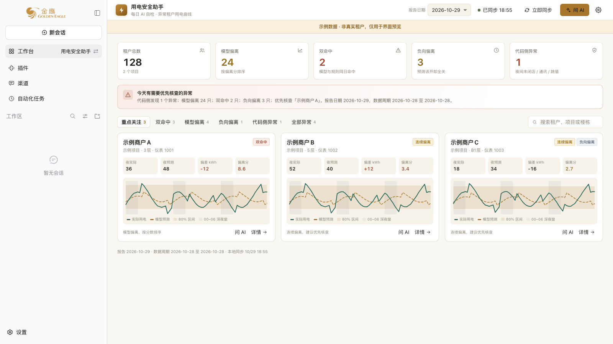

# 用电安全助手

面向能源管理系统 AI 自检报告的整页看板。每天自动拉取最新报告，汇总异常租户，并按租户展示实际/预测用电曲线；需要时再打开 AI 对话。



> 截图使用虚构示例数据，不含真实租户、账号或客户数据。

## 能做什么

- 顶部汇总：租户总数、模型偏离、双命中、负向偏离、代码侧异常。
- 异常租户列表：双命中/连续偏离优先，模型偏离可展开全部，负向偏离和代码侧异常单列。
- 每张租户卡带 72 小时用电曲线：实际用电、模型预测 q50、预测 80% 区间、00–06 深夜窗。
- 每天首次打开自动检查并同步当天报告；也可以手动「立即同步」。
- 需要时点「问 AI」创建/恢复本工作台会话，把当前报告摘要写入对话草稿，由用户确认后发送。

## 适用系统

工作台需要一个提供 AI 自检和用电曲线接口的能源管理系统，接口路径与 GE-Energy 能源管理系统兼容：

- `POST /api/auth/login`
- `GET /api/ai-check/results`
- `GET /api/ai-check/results/:id`
- `GET /api/ai-check/timesnet`
- `GET /api/forecast/meter-curve`

只需要只读账号。工作台不会修改能源系统里的配置或记录。系统地址在首次使用时填写，不写死在代码里。

## 首次使用

1. 打开工作台，填写能源系统地址、用户名和密码。
2. 账号保存在本机工作台数据目录的 `connection.env`（权限 600）；不写入对话记录，也不上传。
3. 工作台只读取 AI 自检、租户和用电曲线数据。

## 安装

通过金鹰 Agent 工作台市场安装，或从本仓库源码安装。仓库默认分支已经包含构建好的 `lib/client.js`，安装时不需要运行构建。

## 开发

```bash
npm install
npm run build
npm test
```

客户端入口会被构建为单文件 `lib/client.js`，由金鹰 Agent 的模块加载器加载。

## 截图

`docs/images/` 中的截图使用虚构示例数据，不含真实租户、账号或客户数据。

## 目录

```text
dsh/index.js       服务端：登录、同步、缓存、本机接口
src/entry.jsx      客户端入口与模块注册
src/panel.jsx      业务面板
src/styles.js      样式
lib/client.js      构建后的客户端单文件
test/              服务端与客户端契约测试
```

## 许可证

MIT。仓库地址：https://github.com/Zcx-BaixiaoBai/ge-workbench-electric-safety